**English** | [Italiano](./README_IT.md)

```
 ____            _
| __ ) _   _  __| | __ _  ___  ___
|  _ \| | | |/ _` |/ _` |/ _ \/ _ \
| |_) | |_| | (_| | (_| |  __/  __/
|____/ \__,_|\__,_|\__, |\___|\___|
                   |___/
```

# Budgee - Personal Finance Manager

A free web app to track expenses, income, budgets, investments and loans, installable on any device and synced across them.


[Open the app](https://financial-management-by-bonn.web.app) · [Try the demo](https://financial-management-by-bonn.web.app) · [Read the user guide](./USER_GUIDE.md)

Budgee is a Progressive Web App (PWA) for personal finance. You record expenses and income, set monthly budgets, follow investments, crypto and loans, keep financial documents on Google Drive and set savings goals, from a phone or a computer, with the same data on every device.

It was built for people who keep their finances in a notebook or a messy spreadsheet and want something easier without giving up detail. There is no subscription, no premium tier and no advertising. It works offline and syncs when the connection comes back, and it keeps a weekly backup on your own Google Drive.

## In practice

A walkthrough on sample data: the expenses dashboard down to the spending map, a new expense, a search with its statistics, the year-on-year comparison opened on one cell, the crypto position and the budget.

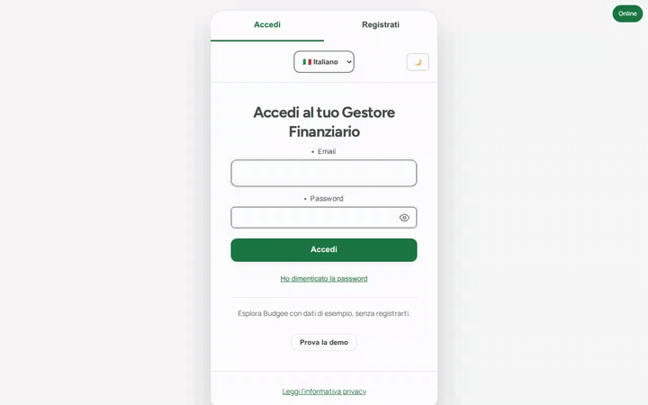

[Watch it as a video](./docs/media/budgee-demo.mp4)

To try it without registering, open [financial-management-by-bonn.web.app](https://financial-management-by-bonn.web.app) and click **Try the demo** on the sign-in screen. The whole app opens with sample data that you can browse and edit. Nothing reaches the cloud: the demo lives in that browser tab and disappears when you close it. The features that need real external services (Google Drive, receipt scanning, account export and deletion, password reset) say so instead of running.

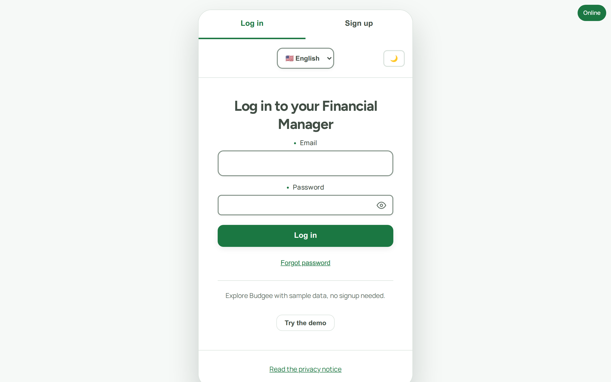

## Table of contents

- [Tech stack](#tech-stack)
- [Architecture](#architecture)
- [Installation](#installation)
- [Features](#features)
  - [Finding your way around](#finding-your-way-around)
  - [Expenses and income](#expenses-and-income)
  - [Searching, with statistics](#searching-with-statistics)
  - [Scanning a receipt instead of typing it](#scanning-a-receipt-instead-of-typing-it)
  - [Spending by country](#spending-by-country)
  - [Cash outflows](#cash-outflows)
  - [Meal vouchers](#meal-vouchers)
  - [Budget](#budget)
  - [Savings](#savings)
  - [Investments](#investments)
  - [Crypto portfolio](#crypto-portfolio)
  - [Loans and financing](#loans-and-financing)
  - [Open accounts](#open-accounts)
  - [Savings goals](#savings-goals)
  - [Recurring transactions](#recurring-transactions)
  - [Insights and the year-on-year comparison](#insights-and-the-year-on-year-comparison)
  - [Tax-deductible expenses](#tax-deductible-expenses)
  - [Documents and the weekly backup](#documents-and-the-weekly-backup)
  - [Documents for your accountant](#documents-for-your-accountant)
  - [Your data and your privacy](#your-data-and-your-privacy)
  - [Languages, theme and mobile](#languages-theme-and-mobile)
  - [When a new version ships](#when-a-new-version-ships)
- [Contributing](#contributing)
- [Team and maintainers](#team-and-maintainers)
- [Security](#security)
- [License](#license)
- [Support the project](#support-the-project)

## Tech stack

| Layer | Technology |
|-------|-----------|
| Frontend | Vanilla JavaScript (ES modules, no framework), HTML5, CSS3 with custom properties |
| Charts | Chart.js, served from the app's own domain |
| Backend | Firebase Authentication, Firestore and Hosting. No server-side code of its own: the logic runs in the browser and the Firestore security rules are the only trust boundary |
| Offline | Service Worker with Network-First caching, plus the Firestore SDK's local cache |
| Storage | Transactions split into monthly documents, so an account keeps growing past the size limit of a single record |
| Documents and backup | Google Drive API with OAuth 2.0 |
| Receipt scanning | Google Gemini, with an API key the user supplies |
| Market data | Exchange rates from exchangerate-api.com, crypto prices from CoinGecko |
| Import and export | SheetJS for Excel, fflate for ZIP archives |

## Architecture

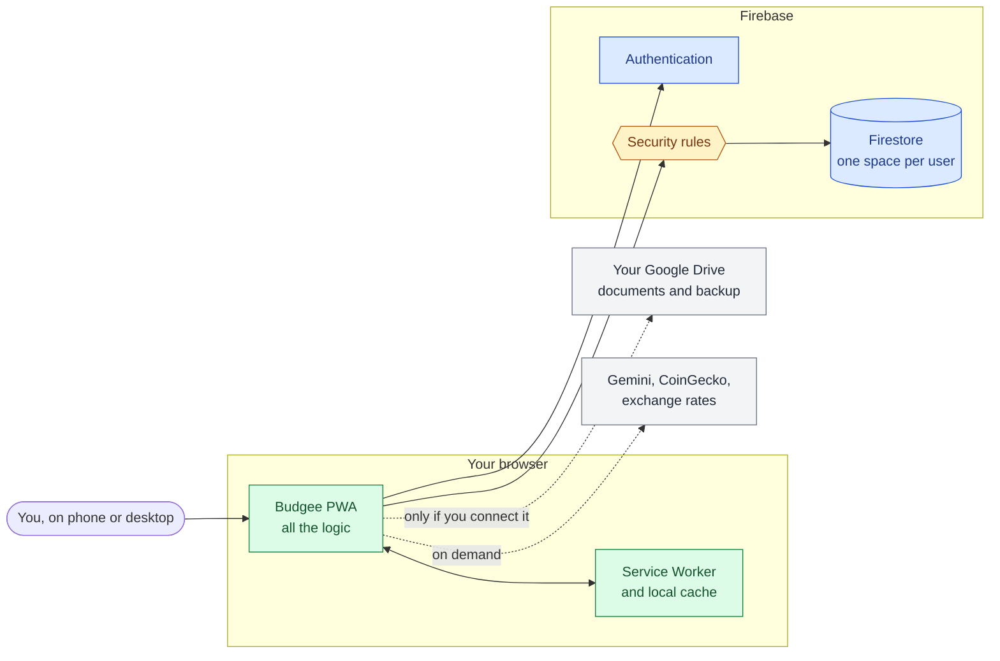

Everything you see is computed in the browser. Firestore holds your data and its rules decide who can read it; the dashed services are called only for the feature that needs them: Drive when you connect it, Gemini when you scan a receipt with your own key, CoinGecko when you hold crypto, the exchange rates when you use more than one currency.

## Installation

Budgee is a hosted web app: there is nothing to download from this repository.

1. Open [financial-management-by-bonn.web.app](https://financial-management-by-bonn.web.app) in Chrome, Safari, Firefox or Edge.
2. Tap **Register**, enter an email and a password, and accept the terms of use. Click the link in the verification email to activate the account.
3. Optional: install it. On mobile the browser offers "Add to Home Screen"; on desktop, look for the install icon in the address bar. Budgee then opens like a native app.
4. Add a few expenses and income entries from the current month. Each one needs an amount, a category, a date and a payment method.
5. Open **Budget** and set limits for the categories you want to watch.

The [user guide](./USER_GUIDE.md) walks through every section step by step.

## Features

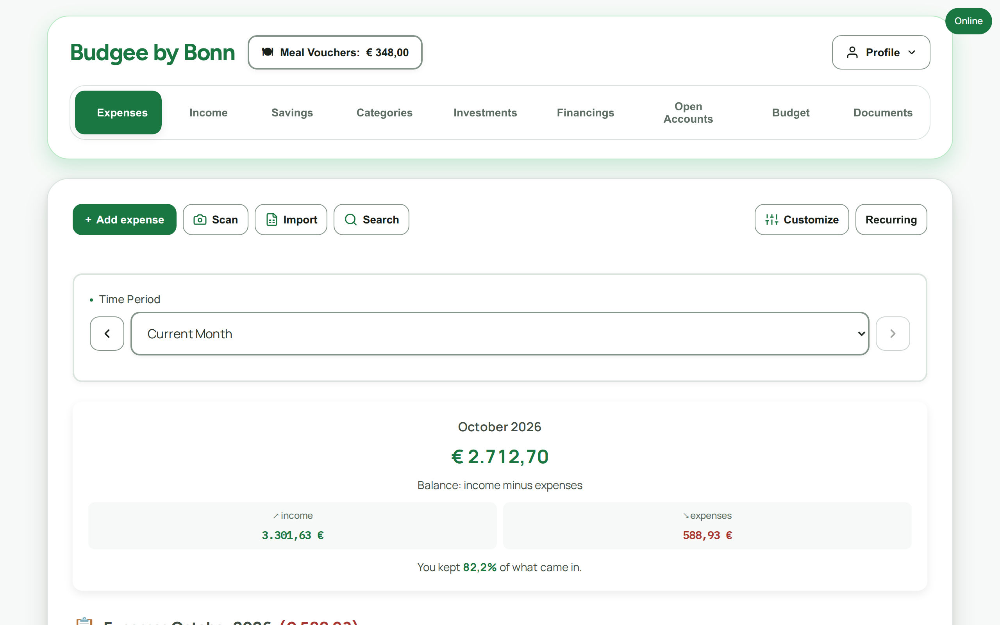

*The Expenses tab: the action bar on top, the period selector, and the month's balance with income, spending and how much of the income you kept.*

### Finding your way around

The tabs along the top lead to the sections: Expenses, Income, Savings, Categories, Investments, Loans, Open accounts, Budget and Documents. Every section opens with the same action bar: add, scan, import, search, customise which blocks you see, and manage recurring entries.

The **Profile** menu in the header gathers what used to be a row of icons: your profile, the home country, the currency, the language, light or dark theme, the guide and sign out. The meal voucher balance sits next to it, for those who use them.

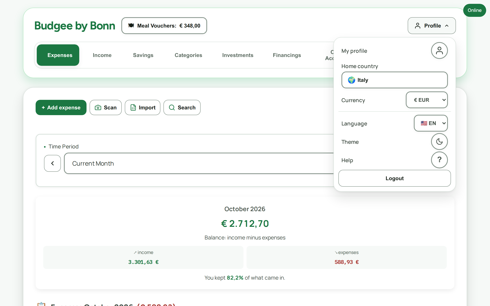

### Expenses and income

For every transaction you can set:

- Amount and currency (EUR, USD, GBP, PLN)
- Category and subcategory, from a hierarchy you can customise
- A free-text description and a date
- The payment method: cash, card or app, cheque, bank transfer, crypto, direct debit for expenses, voucher for income, meal voucher for both. It is required when you fill the form by hand and comes pre-selected with the method you normally use for that category
- The country where you spent the money, if different from home
- A link to a loan instalment or to an investment, behind a toggle so the form stays short when you do not need it
- The tax-deductible flag and a recurring frequency

Other things you can do:

- Import transactions in bulk from an `.xlsx` file, and export to CSV or Excel
- Find the currency you used last time already selected: every form keeps its own memory
- Read live statistics: daily average, projected month-end total, highest-spending day
- Follow the month on a daily calendar and on a cumulative trend that draws the month's budget as a line, so you see the day you are going to cross it

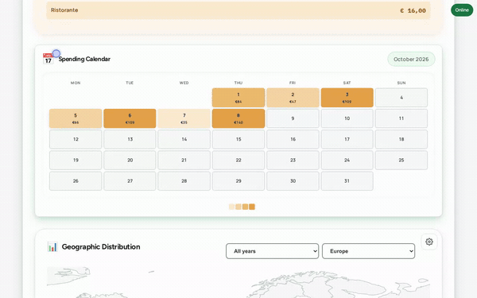

*The calendar marks the days with higher spending; the trend below builds up day by day against the budget.*

### Searching, with statistics

The search button opens a search across expenses, income, investments, loans and open accounts, with filters on category, period, amount, payment method, linked item and country. On expenses and income a bar above the results gives the count, the total and the average of what was found, and **Stats** opens the breakdown by category, a month-by-month chart and the highlights.

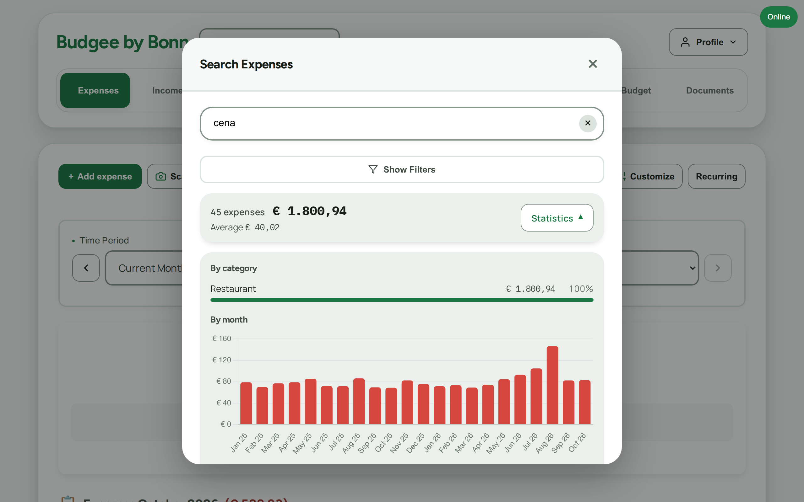

*Searching "cena" across two years of data: 45 expenses, their total and average, and how they spread over the months.*

A result opens in place with its details and the edit and delete buttons. After an edit the search comes back to the same spot in the list instead of starting over.

### Scanning a receipt instead of typing it

**Scan** opens the AI scan: upload a photo or a PDF, and the amount, date, description and category land in the form already filled in. You check them and save, so nothing is written without you seeing it.

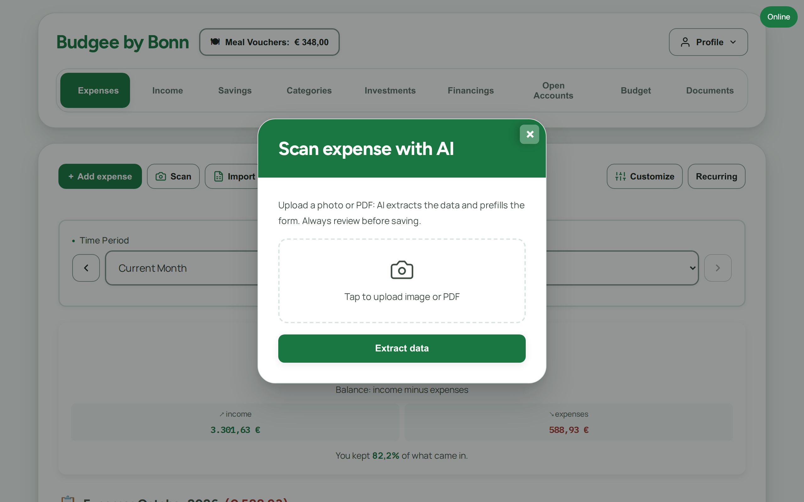

Three things are worth knowing:

- The scan runs on Google Gemini with an API key you enter in your profile. Without a key the feature stays off.
- The image leaves Budgee, so it asks for a separate consent the first time, and you can withdraw it from the same screen.
- If you scan an invoice that looks like income while the expense form is open, Budgee stops and asks which of the two it is.

On a phone you can also share a photo straight from the gallery or the camera: Budgee shows up among the apps you can share to and opens on the scan with the image loaded.

### Spending by country

Set your home country in the profile menu and every expense records where it was made. Past expenses take the home country silently the first time you choose it; a trip abroad is a field in the form, and foreign expenses carry a flag in the list, and the search filters by country. Recurring expenses, CSV and Excel carry the country too.

The Expenses tab then maps where your money went, with a year selector and a continent selector that opens on the continent you travelled to most.

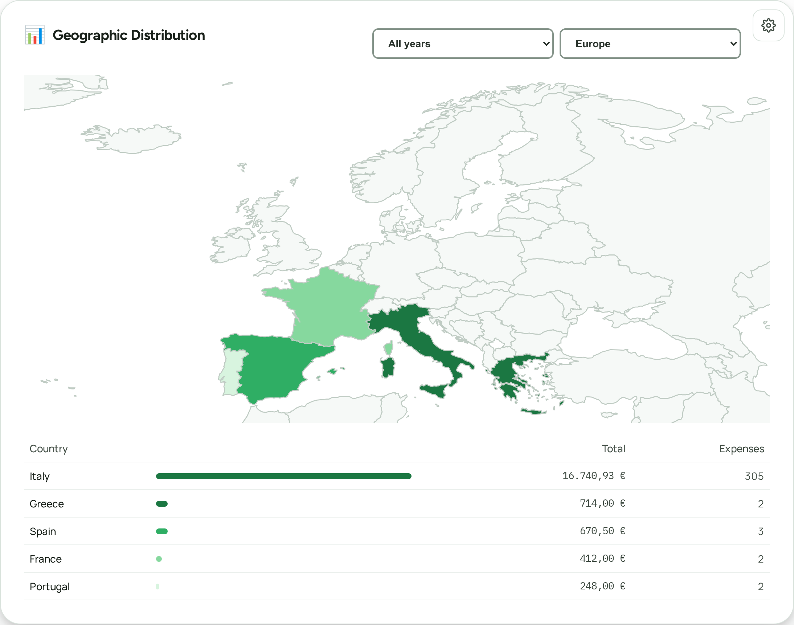

*The darker the country, the more you spent there. The table under the map gives totals and counts.*

The gear on the section counts the expenses that still have no country and lists them: you pick a country, tick the expenses it applies to and save once.

### Cash outflows

Cash is the part of a budget that is easiest to lose track of. The Expenses tab charts how much of your spending goes through it, month by month and category by category, and says how much of the total is still unmeasured because the payment method is missing.

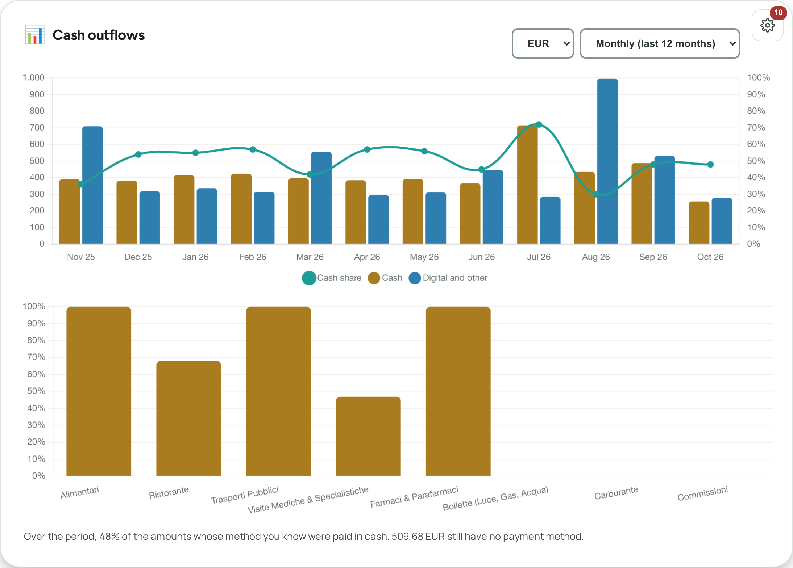

*The share is measured on amounts, not on the number of entries: ten coffees do not weigh as much as a rent payment.*

If your history predates the payment method field, the gear on this section shows the coverage and fills the gaps in bulk, one category at a time, suggesting the method you use most often for each.

### Meal vouchers

If you get them, you carry a second currency around: real money, spendable only in certain places. The "meal voucher" method works on income as well as on expenses, because a voucher is first received and then spent. You declare that you have them in your profile, set an opening balance with its date, and from there every movement paid in vouchers moves the counter.

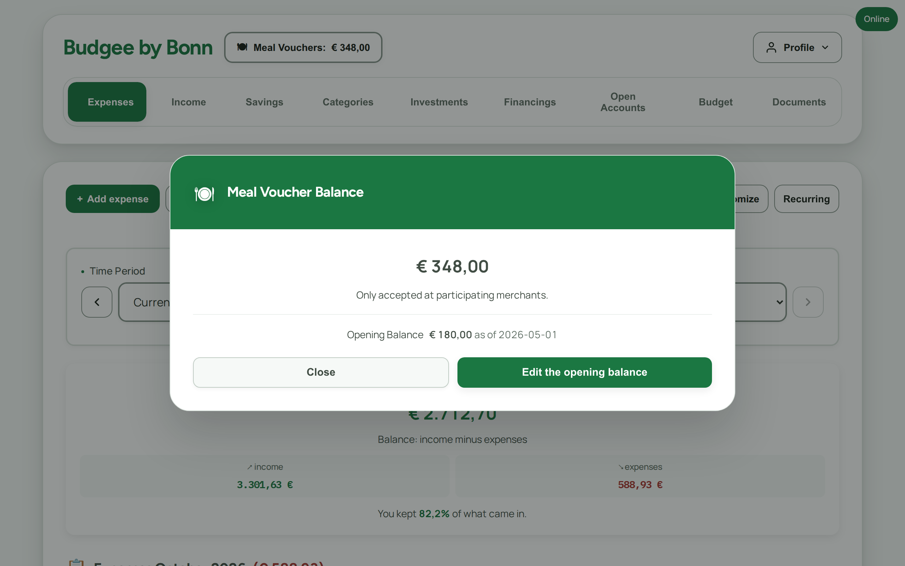

*The balance is derived from your movements starting at the figure you declared. Until that figure exists the panel says so, rather than showing a zero that would look like data.*

Meal vouchers stay out of your liquidity: adding them in would claim that money is available for the rent. In period totals, budgets and savings they count like any other movement. Turning the feature off hides it without erasing anything.

### Budget

Set a monthly spending limit for each category. Budgee shows how much you spent against the limit with progress bars, how much you can still spend per day to stay inside it, and lets you copy last month's limits in one click. Budgets follow the category hierarchy: macro-category first, then subcategories.

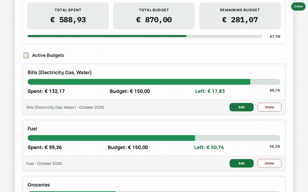

### Savings

The Savings tab derives what you kept from income minus expenses: the current balance and the invested capital, the total saved, the average saving rate, the best and worst months. One chart switches between three views: month by month, cumulative, and saving rate.

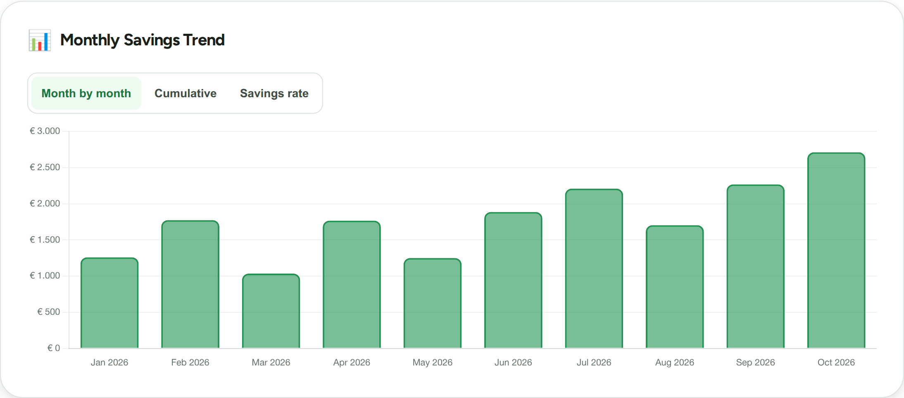

### Investments

Your portfolio in one place:

- Bonds, deposit accounts, stocks, funds, ETFs, crypto, real estate and more
- Invested amount, subscription date, interest rate, maturity, expected gross and net return, actual return, notes
- Dividends, interest and rent linked to the investment that produced them; extra contributions linked from an expense
- A movement history per investment, each movement editable or removable after the fact, and recurring returns for what pays on a schedule
- Portfolio totals: invested capital, expected and actual returns, average rate, next maturity

Management fees have their own place. When you link an expense to an investment you say whether it is new capital or a fee: fees stay out of the invested capital, the card shows them next to the net return, and the actual return is labelled gross with the net figure beside it.

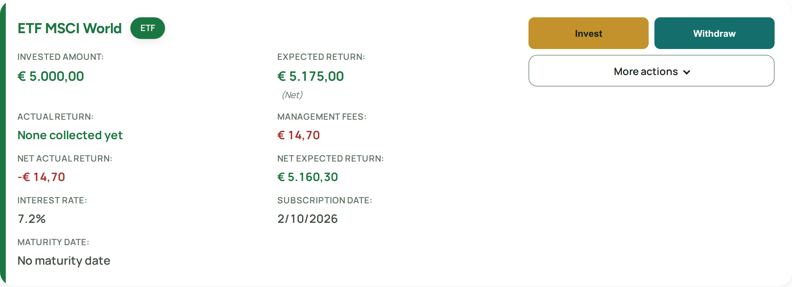

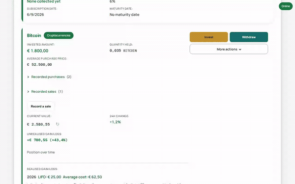

### Crypto portfolio

A crypto investment is a register of purchases, not a single amount. Each lot has its quantity, unit price and date; the card shows the quantity held, the average cost, the lots and the sales.

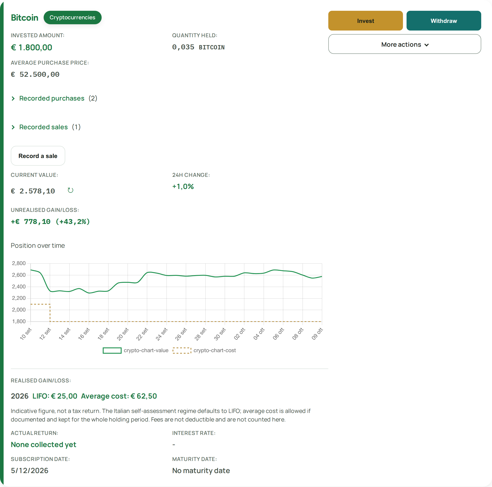

*Market value, daily change and unrealised gain come from the current price; the chart compares the position with what it cost.*

- The price comes from CoinGecko and always carries the time it was read. A price older than ten minutes is shown with its date, and a price that could not be read is never replaced by a guess. A button asks for a fresh one.
- A partial sale is recorded from the card. The realised gain is shown per year under two methods side by side, LIFO and average cost, because on a partial sale they can differ and even have opposite signs. The page states that the figure is indicative and not a tax return.
- What the app counts as invested is what you paid, never the market value, and gains do not enter any total: your net worth does not move with the price of bitcoin.
- The position travels in the CSV export.

### Loans and financing

Mortgages, car loans, personal and student loans, phone financing and more: amount, dates, instalments, rate, paid and remaining, with progress bars, a detail view with the payment history and amortization schedule, and expenses linked to the instalments they pay.

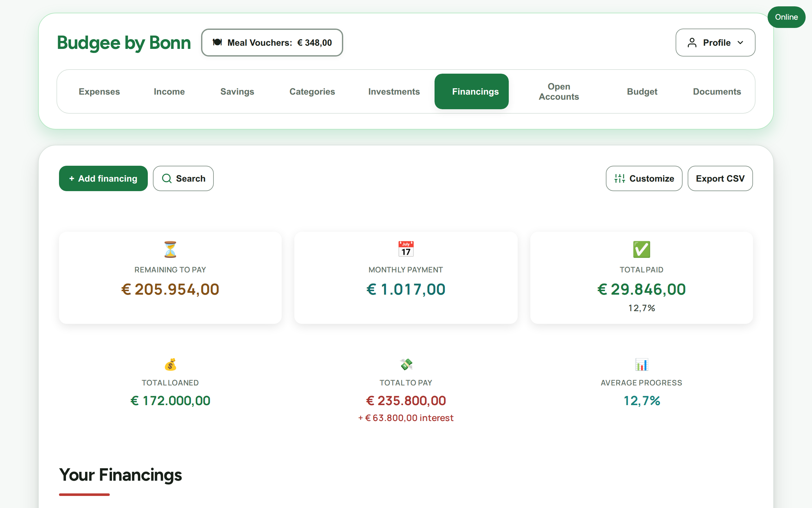

### Open accounts

Money you owe and money owed to you, per person or supplier: amounts, payment history, accounts that close themselves when the balance reaches zero, totals for credits, debts and net balance, search and CSV export.

### Savings goals

One-off goals with a deadline or ongoing ones, with target, saved amount, the monthly amount needed to hit the deadline, colour-coded progress, priority, and an archive for completed goals. The liquidity card shows how much of your balance is set aside for goals.

### Recurring transactions

Rent, salary, subscriptions, utilities: daily, weekly, monthly (first, last or a given day) or yearly. Each occurrence asks to be confirmed before it lands in your records, so nothing is added behind your back. Amount, description and method stay editable, and a single occurrence or all future ones can be deleted.

### Insights and the year-on-year comparison

The Categories tab ranks spending by macro-category with drill-down to subcategories, compares income and expense categories, and adds pattern detection with short suggestions.

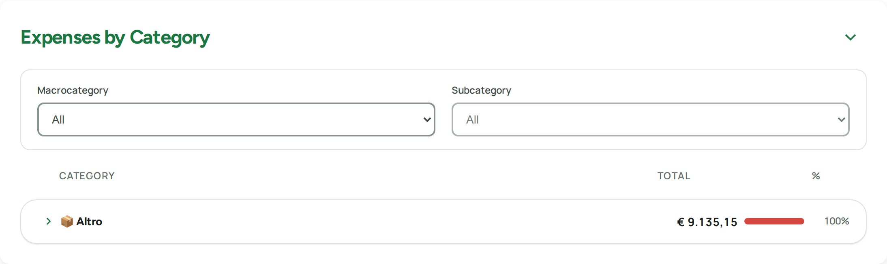

It also compares two whole years, one category at a time, or the same stretch of both years up to today's date. A category present in one year only stays in the table with the other year at zero, because a line that disappears is usually the one worth looking at.

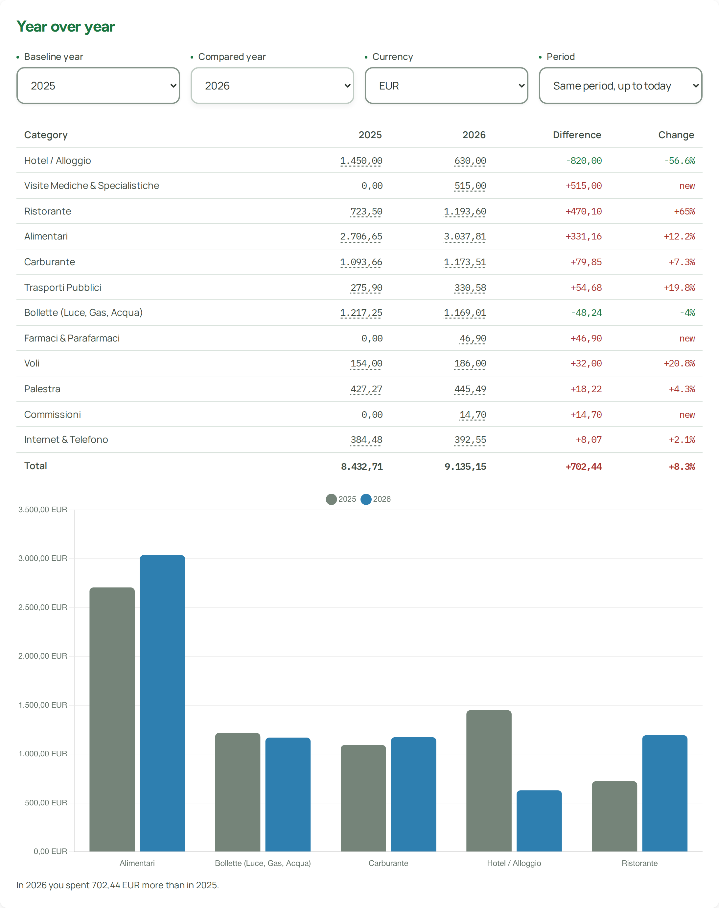

Every amount in the table opens the expenses behind it, and each one can be edited or deleted from there.

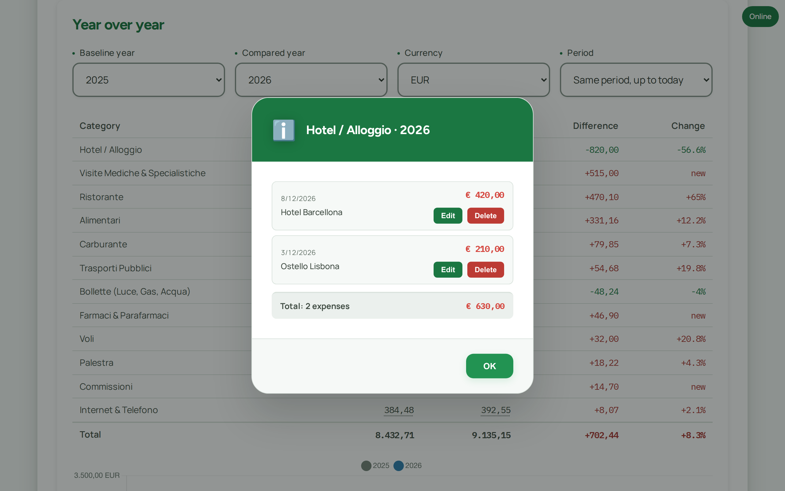

### Tax-deductible expenses

Flag expenses as deductible as you record them, see them per tax year with the breakdown by category, add deductibles that have no matching expense, and get recurring deductibles flagged automatically.

### Documents and the weekly backup

The Documents tab connects Google Drive: 32 predefined folders (payslips, invoices, medical reports, contracts, insurance, taxes, vehicles and more), organised per year, translated in your language, opened with one click. Authentication goes through OAuth 2.0; Budgee only sees the files it created.

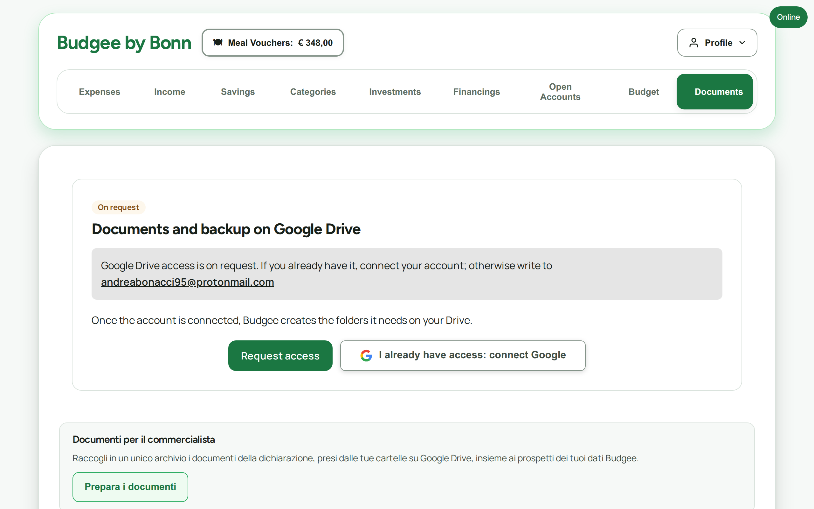

Once Drive is connected, Budgee writes a copy of your data into a **Budgee Backup** folder every seven days and keeps the last eight. There is no server, so the backup runs when you open the app: if you do not open it for two weeks, the copy waits for you, and the app tells you when the last one actually ran.

### Documents for your accountant

At tax time the hard part is remembering what to hand over. The **Documents for your accountant** wizard, in the Documents tab, asks which return you file, which year and which situations apply to you, then walks you through the relevant sections and points at the Drive folder where each paper normally lives.

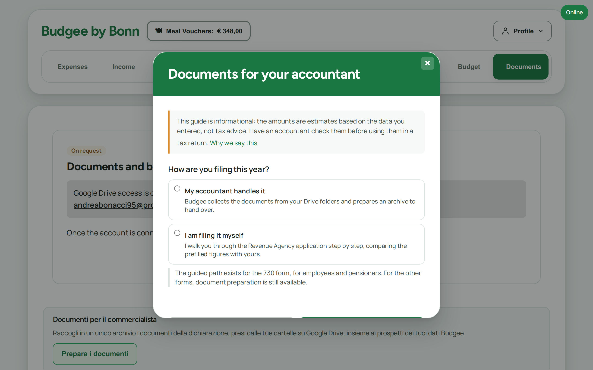

What comes out is a single ZIP with the documents you picked, your deductible expenses for the year with totals, the list of what is missing (mandatory apart from optional), a note about deductible expenses paid in cash, and the list of things that do not belong in a folder, such as your IBAN, named without being included. The wizard follows the Italian rules for the tax year you pick, and a notice at the top says the amounts are estimates for an accountant to check.

### Your data and your privacy

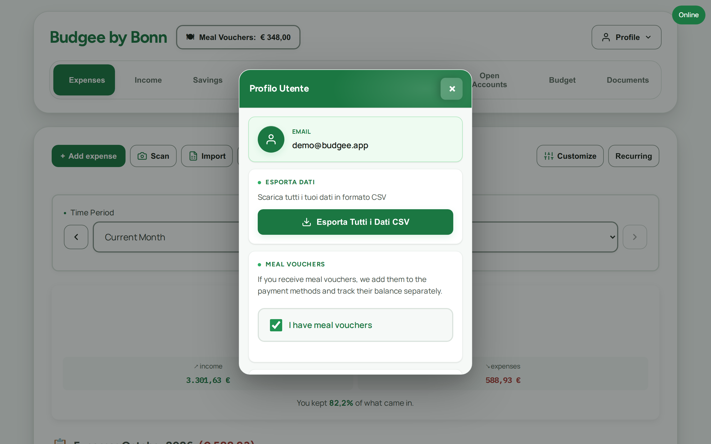

- **Take everything with you.** One button downloads the whole account as a ZIP: a full JSON plus a CSV per section, read from the database rather than from memory. The Gemini API key is left out on purpose.
- **Delete the account for good.** Deletion goes through every part of the account and asks for your password. If it is interrupted, the next login picks it up where it stopped.
- **Read what is collected.** The [privacy notice](https://financial-management-by-bonn.web.app/src/pages/privacy.html), in Italian and English, is reachable from the sign-in screen, because collection starts when you register.
- **Know what you agree to.** Registration asks you to accept the [terms of use](https://financial-management-by-bonn.web.app/src/pages/terms.html), with the box never pre-ticked. The acceptance is recorded with the version of the text and a server timestamp, and nobody can rewrite it afterwards.
- **Say no to the AI.** Receipt scanning is off until you turn it on and asks for a consent of its own.

Each user can only access their own data, enforced by the database rules; there is no tracking and no advertising.

### Languages, theme and mobile

Italian and English, chosen from the profile menu. Interface, categories, charts and folder names follow the language. The privacy notice and the terms appear only in languages where a person has read the text: an interface can fall back to another language, a binding document cannot.

Light or dark theme, saved and synced:

<div align="center">
<table>
<tr>
<td></td>
<td>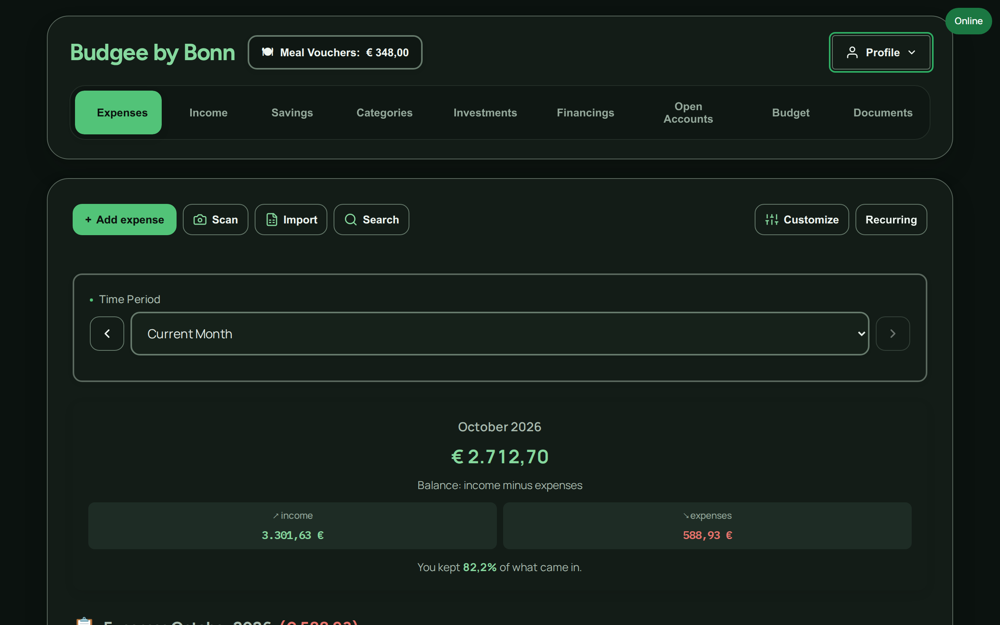</td>
</tr>
<tr>
<td align="center"><em>Light mode</em></td>
<td align="center"><em>Dark mode</em></td>
</tr>
</table>
</div>

On a phone the sections move to a tab bar at the bottom: Expenses, Income, Savings and Budget at hand, the rest under **More**. First-time users get a guided tour of the main features.

<div align="center">
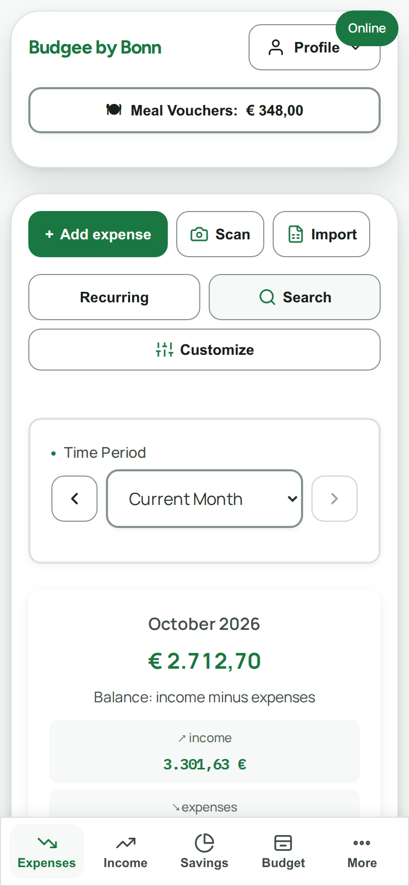
&nbsp;&nbsp;&nbsp;
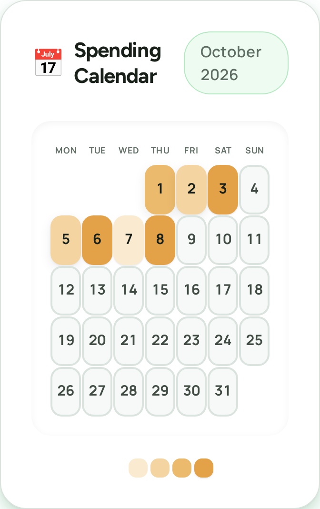
</div>

### When a new version ships

On open, Budgee checks whether a new version has been published and asks: update now, or later. Until you accept you keep the version you opened, so the app does not change under your hands while you are entering an expense.

## Contributing

The source code is private, so contributions come as feedback. The [feedback guide](./FEEDBACK.md) explains how to report a bug in a way that can be acted on, request a feature or ask for support. Quick contact: andreabonacci95@protonmail.com

## Team and maintainers

Built and maintained by Andrea Bonacci - [github.com/AndreaBonn](https://github.com/AndreaBonn)

## Security

The detailed inventory of security measures, and how to report a vulnerability, is in [SECURITY.md](./SECURITY.md).

## License

Proprietary. The web app is free for personal use; the source code is not distributed. See [LICENSE](./LICENSE).

## Support the project

If Budgee turned out to be useful, a star on this repository helps others find it.

Budgee is free to use. If you want to give something back, you can leave a tip via PayPal; the amount is up to you and entirely optional.

<div align="center">

[](https://paypal.me/AndreaBonacci19)

**© 2025-2026 Andrea Bonacci**

</div>
