[English](./README.md) | **Italiano**

```
 ____            _
| __ ) _   _  __| | __ _  ___  ___
|  _ \| | | |/ _` |/ _` |/ _ \/ _ \
| |_) | |_| | (_| | (_| |  __/  __/
|____/ \__,_|\__,_|\__, |\___|\___|
                   |___/
```

# Budgee - Gestione delle finanze personali

Una web app gratuita per tenere traccia di spese, entrate, budget, investimenti e finanziamenti, installabile su qualsiasi dispositivo e sincronizzata fra tutti.


[Apri l'app](https://financial-management-by-bonn.web.app) · [Prova la demo](https://financial-management-by-bonn.web.app) · [Leggi la guida utente](./USER_GUIDE_IT.md)

Budgee è una Progressive Web App (PWA) per le finanze personali. Registri spese ed entrate, imposti budget mensili, segui investimenti, crypto e finanziamenti, conservi i documenti finanziari su Google Drive e fissi obiettivi di risparmio, dal telefono o dal computer, con gli stessi dati su ogni dispositivo.

È nata per chi tiene i conti su un quaderno o su un foglio di calcolo disordinato e vuole qualcosa di più semplice senza rinunciare al dettaglio. Niente abbonamento, niente versione premium, niente pubblicità. Funziona offline e si sincronizza quando torna la connessione, e tiene un backup settimanale sul tuo Google Drive.

## In pratica

Un giro su dati di esempio: la dashboard delle spese fino alla mappa per paese, una spesa nuova, una ricerca con le sue statistiche, il confronto anno su anno aperto su una cella, la posizione crypto e il budget.


[Guardalo come video](./docs/media/budgee-demo.mp4)

Per provarla senza registrarti, apri [financial-management-by-bonn.web.app](https://financial-management-by-bonn.web.app) e premi **Prova la demo** nella schermata di accesso. Si apre l'app intera con dati di esempio, che puoi sfogliare e modificare. Nulla arriva al cloud: la demo vive in quella scheda del browser e sparisce quando la chiudi. Le funzioni che richiedono servizi esterni veri (Google Drive, scansione degli scontrini, esportazione ed eliminazione dell'account, reimpostazione della password) lo dicono invece di partire.

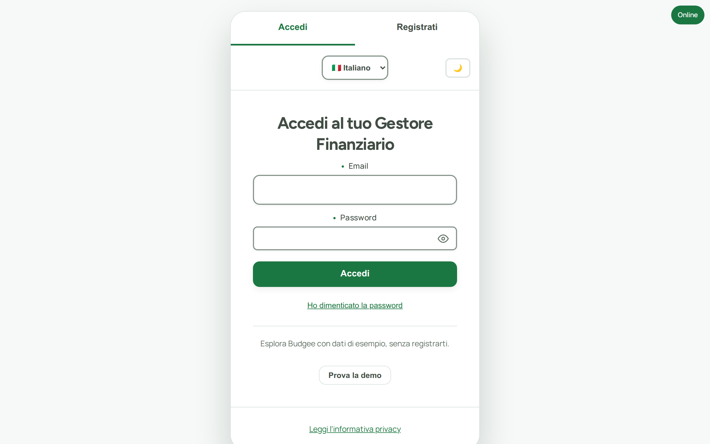

## Indice

- [Stack tecnologico](#stack-tecnologico)
- [Architettura](#architettura)
- [Installazione](#installazione)
- [Funzionalità](#funzionalità)
  - [Orientarsi](#orientarsi)
  - [Spese ed entrate](#spese-ed-entrate)
  - [Cercare, con le statistiche](#cercare-con-le-statistiche)
  - [Scansionare uno scontrino invece di digitarlo](#scansionare-uno-scontrino-invece-di-digitarlo)
  - [Spese per paese](#spese-per-paese)
  - [Uscite in contanti](#uscite-in-contanti)
  - [Buoni pasto](#buoni-pasto)
  - [Budget](#budget)
  - [Risparmi](#risparmi)
  - [Investimenti](#investimenti)
  - [Portafoglio crypto](#portafoglio-crypto)
  - [Finanziamenti](#finanziamenti)
  - [Conti aperti](#conti-aperti)
  - [Obiettivi di risparmio](#obiettivi-di-risparmio)
  - [Transazioni ricorrenti](#transazioni-ricorrenti)
  - [Analisi e confronto anno su anno](#analisi-e-confronto-anno-su-anno)
  - [Spese detraibili](#spese-detraibili)
  - [Documenti e backup settimanale](#documenti-e-backup-settimanale)
  - [Documenti per il commercialista](#documenti-per-il-commercialista)
  - [I tuoi dati e la tua privacy](#i-tuoi-dati-e-la-tua-privacy)
  - [Lingue, tema e mobile](#lingue-tema-e-mobile)
  - [Quando esce una nuova versione](#quando-esce-una-nuova-versione)
- [Come contribuire](#come-contribuire)
- [Team e maintainer](#team-e-maintainer)
- [Sicurezza](#sicurezza)
- [Licenza](#licenza)
- [Supporta il progetto](#supporta-il-progetto)

## Stack tecnologico

| Livello | Tecnologia |
|---------|-----------|
| Frontend | JavaScript puro (moduli ES, nessun framework), HTML5, CSS3 con custom properties |
| Grafici | Chart.js, servito dal dominio dell'app |
| Backend | Firebase Authentication, Firestore e Hosting. Nessun codice lato server proprio: la logica gira nel browser e le security rules di Firestore sono l'unico confine di fiducia |
| Offline | Service Worker con cache Network-First, più la cache locale dell'SDK di Firestore |
| Archiviazione | Transazioni suddivise in documenti mensili, così un account continua a crescere oltre il limite di dimensione di un singolo record |
| Documenti e backup | Google Drive API con OAuth 2.0 |
| Scansione scontrini | Google Gemini, con una chiave API fornita dall'utente |
| Dati di mercato | Tassi di cambio da exchangerate-api.com, prezzi crypto da CoinGecko |
| Import ed export | SheetJS per Excel, fflate per gli archivi ZIP |

## Architettura

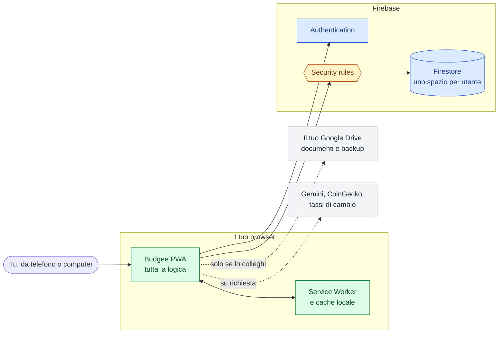

Tutto ciò che vedi è calcolato nel browser. Firestore conserva i tuoi dati e le sue regole decidono chi può leggerli; i servizi tratteggiati vengono chiamati solo per la funzione che li richiede: Drive quando lo colleghi, Gemini quando scansioni uno scontrino con la tua chiave, CoinGecko quando hai delle crypto, i tassi di cambio quando usi più di una valuta.

## Installazione

Budgee è una web app ospitata: da questo repository non c'è niente da scaricare.

1. Apri [financial-management-by-bonn.web.app](https://financial-management-by-bonn.web.app) in Chrome, Safari, Firefox o Edge.
2. Premi **Registrati**, inserisci email e password e accetta i termini d'uso. Clicca il link nell'email di verifica per attivare l'account.
3. Facoltativo: installala. Su mobile il browser propone "Aggiungi a schermata Home"; su desktop cerca l'icona di installazione nella barra degli indirizzi. Da lì Budgee si apre come un'app nativa.
4. Aggiungi qualche spesa ed entrata del mese corrente. Ognuna richiede importo, categoria, data e metodo di pagamento.
5. Apri **Budget** e imposta i limiti per le categorie che vuoi tenere d'occhio.

La [guida utente](./USER_GUIDE_IT.md) percorre ogni sezione passo per passo.

## Funzionalità

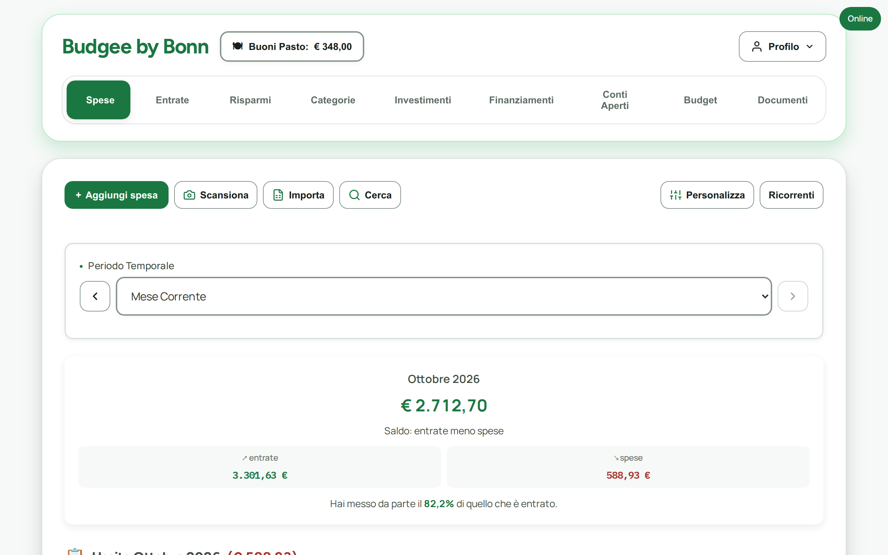

*La scheda Spese: la barra delle azioni in alto, il selettore del periodo e il saldo del mese con entrate, spese e quanto delle entrate hai messo da parte.*

### Orientarsi

Le schede in alto portano alle sezioni: Spese, Entrate, Risparmi, Categorie, Investimenti, Finanziamenti, Conti aperti, Budget e Documenti. Ogni sezione si apre con la stessa barra delle azioni: aggiungi, scansiona, importa, cerca, scegli quali blocchi vedere e gestisci le voci ricorrenti.

Il menu **Profilo** in alto a destra raccoglie quella che prima era una fila di icone: il tuo profilo, la nazione principale, la valuta, la lingua, il tema chiaro o scuro, la guida e l'uscita. Accanto c'è il saldo dei buoni pasto, per chi li usa.


### Spese ed entrate

Per ogni transazione puoi indicare:

- Importo e valuta (EUR, USD, GBP, PLN)
- Categoria e sottocategoria, da una gerarchia personalizzabile
- Una descrizione libera e una data
- Il metodo di pagamento: contanti, carta o app, assegno, bonifico, crypto, addebito diretto per le spese, voucher per le entrate, buono pasto per entrambe. È obbligatorio quando compili il form a mano e arriva preselezionato con il metodo che usi di solito per quella categoria
- Il paese in cui hai speso, se diverso da casa
- Un collegamento a una rata di finanziamento o a un investimento, dietro un interruttore così il form resta corto quando non serve
- Il flag di spesa detraibile e una frequenza di ricorrenza

Altre cose che puoi fare:

- Importare transazioni in blocco da un file `.xlsx`, ed esportarle in CSV o Excel
- Trovare già selezionata la valuta dell'ultima volta: ogni form ha la sua memoria
- Leggere statistiche dal vivo: media giornaliera, totale previsto a fine mese, giorno di spesa più alta
- Seguire il mese su un calendario giornaliero e su un andamento cumulativo che disegna il budget del mese come una linea, così vedi il giorno in cui lo supererai

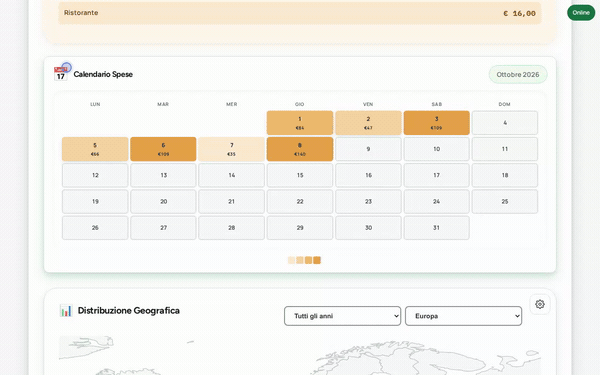

*Il calendario segna i giorni di spesa più alta; l'andamento sotto cresce giorno per giorno contro il budget.*

### Cercare, con le statistiche

Il pulsante di ricerca apre una ricerca su spese, entrate, investimenti, finanziamenti e conti aperti, con filtri per categoria, periodo, importo, metodo di pagamento, elemento collegato e paese. Su spese ed entrate una barra sopra i risultati dà il numero, il totale e la media di ciò che è stato trovato, e **Statistiche** apre la ripartizione per categoria, un grafico mese per mese e i punti salienti.

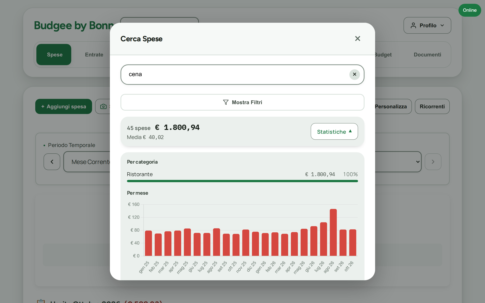

*La ricerca di "cena" su due anni di dati: 45 spese, il loro totale e la media, e come si distribuiscono nei mesi.*

Un risultato si apre sul posto con i suoi dettagli e i pulsanti per modificarlo o eliminarlo. Dopo una modifica la ricerca torna allo stesso punto della lista invece di ricominciare da capo.

### Scansionare uno scontrino invece di digitarlo

**Scansiona** apre la scansione AI: carichi una foto o un PDF, e importo, data, descrizione e categoria arrivano nel form già compilati. Li controlli e salvi, così nulla viene scritto senza che tu l'abbia visto.

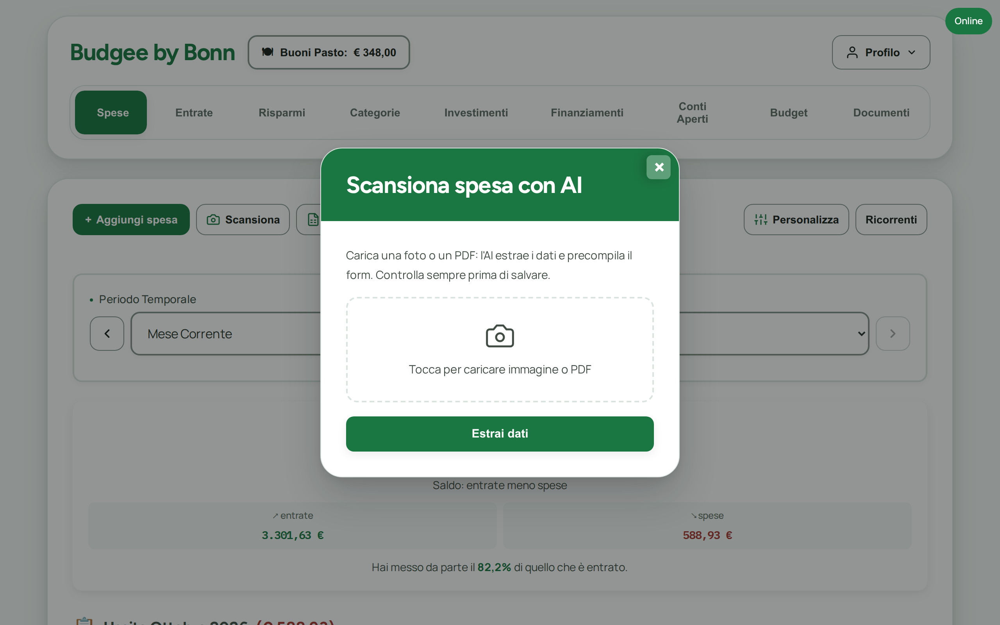

Tre cose da sapere:

- La scansione usa Google Gemini con una chiave API che inserisci nel profilo. Senza chiave la funzione resta spenta.
- L'immagine esce da Budgee, quindi la prima volta chiede un consenso a parte, che puoi ritirare dalla stessa schermata.
- Se scansioni una fattura che sembra un'entrata mentre è aperto il form delle spese, Budgee si ferma e chiede quale delle due è.

Dal telefono puoi anche condividere una foto direttamente dalla galleria o dalla fotocamera: Budgee compare fra le app a cui condividere e si apre sulla scansione con l'immagine già caricata.

### Spese per paese

Imposta la nazione principale nel menu Profilo e ogni spesa registra dove è stata fatta. Le spese passate prendono la nazione principale in silenzio la prima volta che la scegli; un viaggio all'estero è un campo del form, e le spese estere hanno un segno nella lista, e la ricerca filtra per paese. Anche le spese ricorrenti, il CSV ed Excel portano con sé il paese.

La scheda Spese mostra poi su una mappa dove sono finiti i tuoi soldi, con un selettore dell'anno e uno del continente, che si apre sul continente in cui hai viaggiato di più.

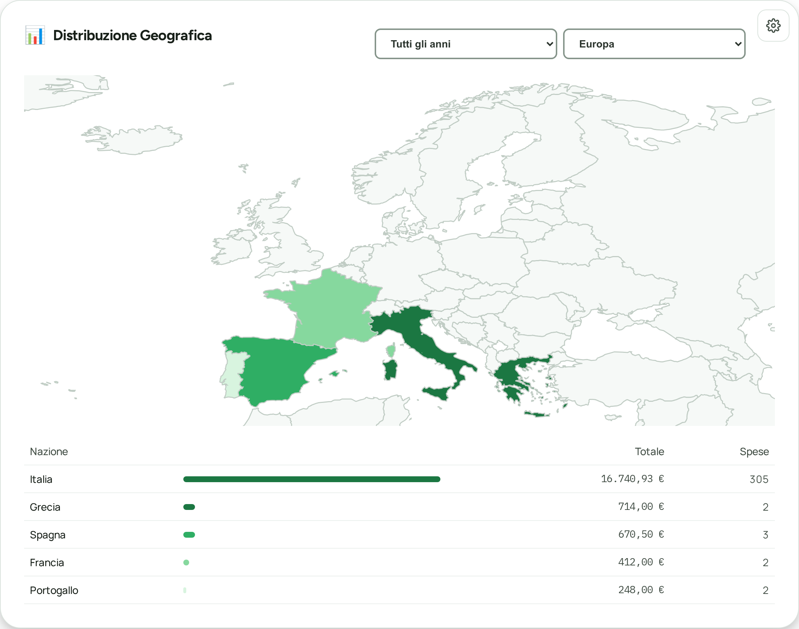

*Più scuro è il paese, più ci hai speso. La tabella sotto la mappa riporta totali e numero di spese.*

L'ingranaggio della sezione conta le spese ancora senza paese e le elenca: scegli un paese, spunti le spese a cui si applica e salvi una volta sola.

### Uscite in contanti

Il contante è la parte del budget di cui si perde traccia più facilmente. La scheda Spese mostra quanto delle tue spese passa da lì, mese per mese e categoria per categoria, e dice quanto del totale resta non misurato perché manca il metodo di pagamento.

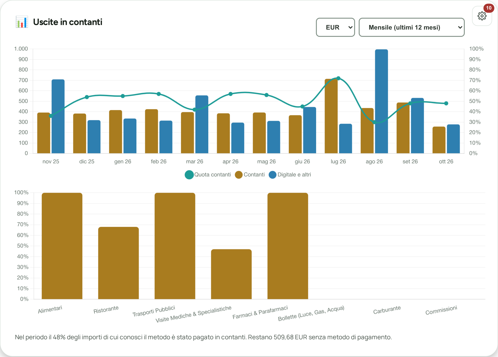

*La quota si misura sugli importi, non sul numero di voci: dieci caffè non pesano quanto un affitto.*

Se il tuo storico è precedente al campo del metodo di pagamento, l'ingranaggio di questa sezione mostra la copertura e riempie i buchi in blocco, una categoria alla volta, proponendo il metodo che usi più spesso per ciascuna.

### Buoni pasto

Se li ricevi, porti in tasca una seconda valuta: denaro vero, spendibile solo in certi posti. Il metodo "buono pasto" vale sulle entrate come sulle spese, perché un buono prima si riceve e poi si spende. Dichiari nel profilo che li hai, imposti un saldo di partenza con la sua data, e da lì ogni movimento pagato in buoni sposta il contatore.

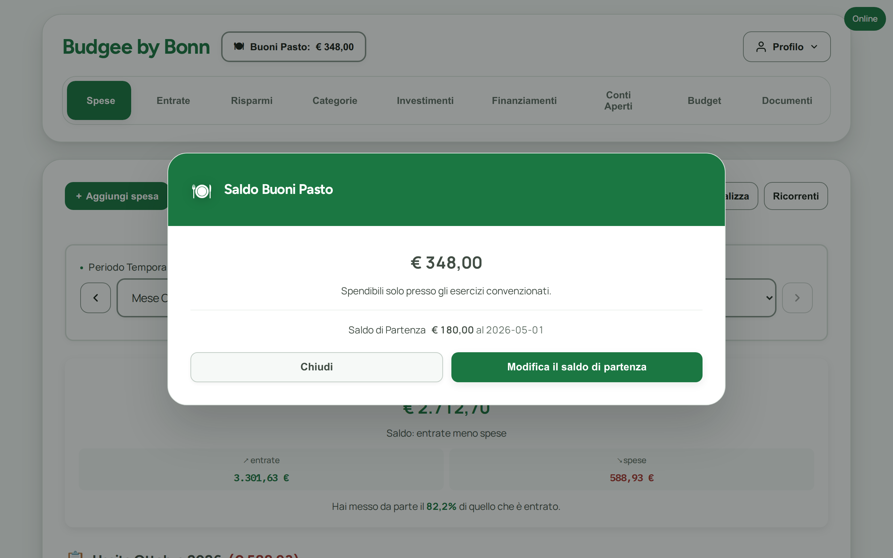

*Il saldo è ricavato dai tuoi movimenti a partire dalla cifra che hai dichiarato. Finché quella cifra non c'è, il pannello lo dice invece di mostrare uno zero che sembrerebbe un dato.*

I buoni pasto restano fuori dalla liquidità: sommarli direbbe che quei soldi sono disponibili per l'affitto. Nei totali di periodo, nei budget e nei risparmi contano come qualsiasi altro movimento. Spegnere la funzione la nasconde senza cancellare niente.

### Budget

Imposta un limite di spesa mensile per ogni categoria. Budgee mostra quanto hai speso rispetto al limite con barre di avanzamento, quanto puoi ancora spendere al giorno per restare dentro, e ti fa copiare i limiti del mese scorso con un clic. I budget seguono la gerarchia delle categorie: prima la macrocategoria, poi le sottocategorie.

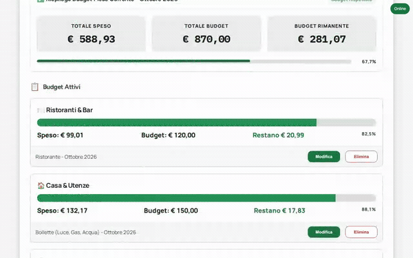

### Risparmi

La scheda Risparmi ricava quanto hai messo da parte da entrate meno spese: il saldo attuale e il capitale investito, il totale risparmiato, il tasso medio di risparmio, il mese migliore e il peggiore. Un unico grafico passa fra tre viste: mese per mese, accumulato e tasso di risparmio.

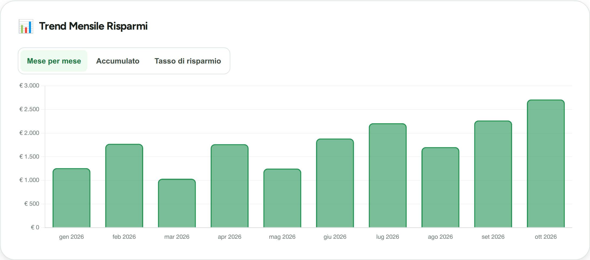

### Investimenti

Il tuo portafoglio in un posto solo:

- Obbligazioni, conti deposito, azioni, fondi, ETF, crypto, immobili e altro
- Importo investito, data di sottoscrizione, tasso, scadenza, rendimento atteso lordo e netto, rendimento effettivo, note
- Dividendi, interessi e affitti collegati all'investimento che li ha prodotti; versamenti aggiuntivi collegati da una spesa
- Lo storico dei movimenti di ogni investimento, ciascuno modificabile o eliminabile anche dopo, e rendimenti ricorrenti per ciò che paga a scadenza fissa
- Totali di portafoglio: capitale investito, rendimenti attesi ed effettivi, tasso medio, prossima scadenza

I costi di gestione hanno un posto loro. Quando colleghi una spesa a un investimento indichi se è capitale nuovo o un costo: i costi restano fuori dal capitale investito, la scheda li mostra accanto al rendimento netto, e il rendimento effettivo è indicato come lordo con il netto al fianco.

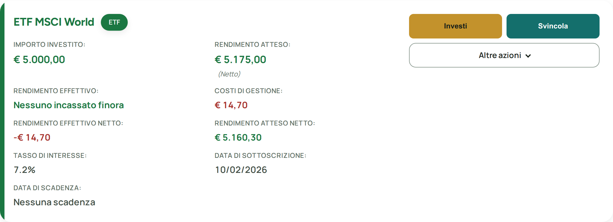

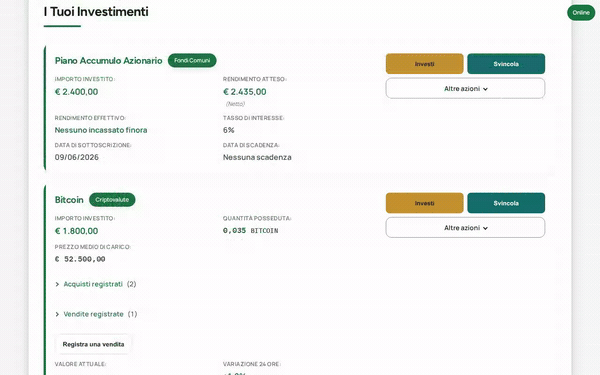

### Portafoglio crypto

Un investimento crypto è un registro di acquisti, non un importo unico. Ogni lotto ha quantità, prezzo unitario e data; la scheda mostra la quantità posseduta, il prezzo medio di carico, i lotti e le vendite.

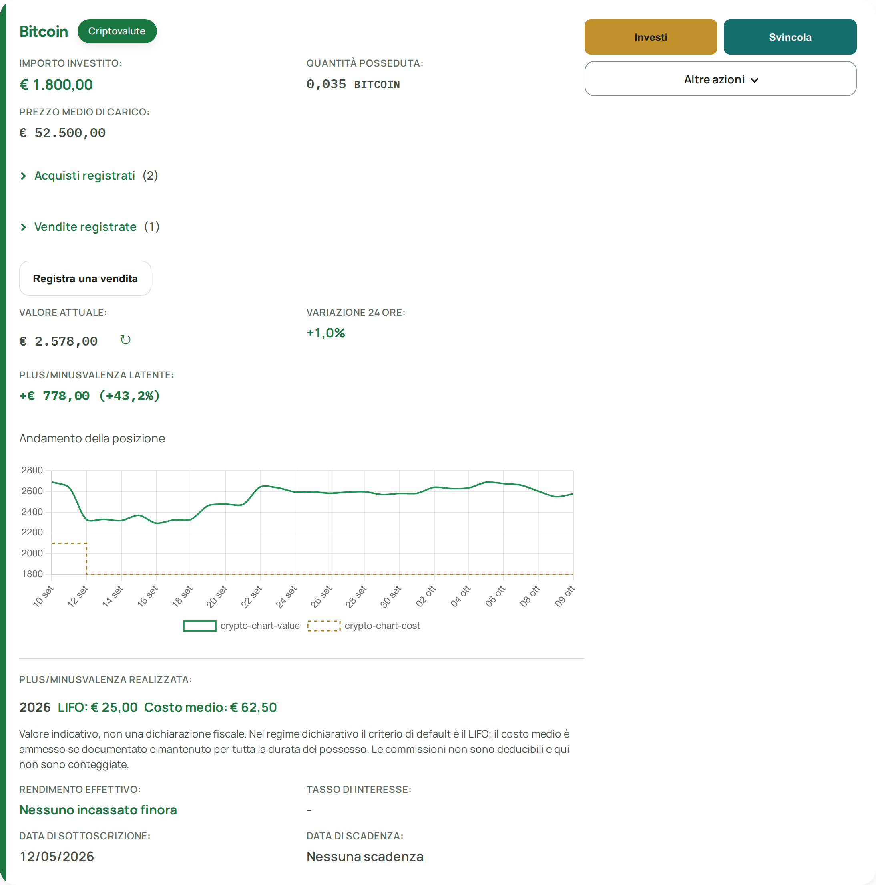

*Valore di mercato, variazione del giorno e plusvalenza latente vengono dal prezzo corrente; il grafico confronta la posizione con quanto è costata.*

- Il prezzo arriva da CoinGecko e porta sempre l'ora in cui è stato letto. Un prezzo più vecchio di dieci minuti si mostra con la sua data, e un prezzo che non è stato possibile leggere non viene mai sostituito da una stima. Un pulsante ne chiede uno aggiornato.
- Una vendita parziale si registra dalla scheda. La plusvalenza realizzata è mostrata per anno con due criteri affiancati, LIFO e costo medio, perché su una vendita parziale possono divergere e avere perfino segno opposto. La pagina dichiara che il numero è indicativo e non è una dichiarazione fiscale.
- Ciò che l'app conta come investito è quanto hai pagato, mai il valore di mercato, e le plusvalenze non entrano in nessun totale: il tuo patrimonio non oscilla con il prezzo del bitcoin.
- La posizione viaggia nell'esportazione CSV.

### Finanziamenti

Mutui, prestiti auto, prestiti personali e d'onore, finanziamenti del telefono e altro: importo, date, rate, tasso, pagato e residuo, con barre di avanzamento, una vista di dettaglio con lo storico dei pagamenti e il piano di ammortamento, e le spese collegate alle rate che pagano.

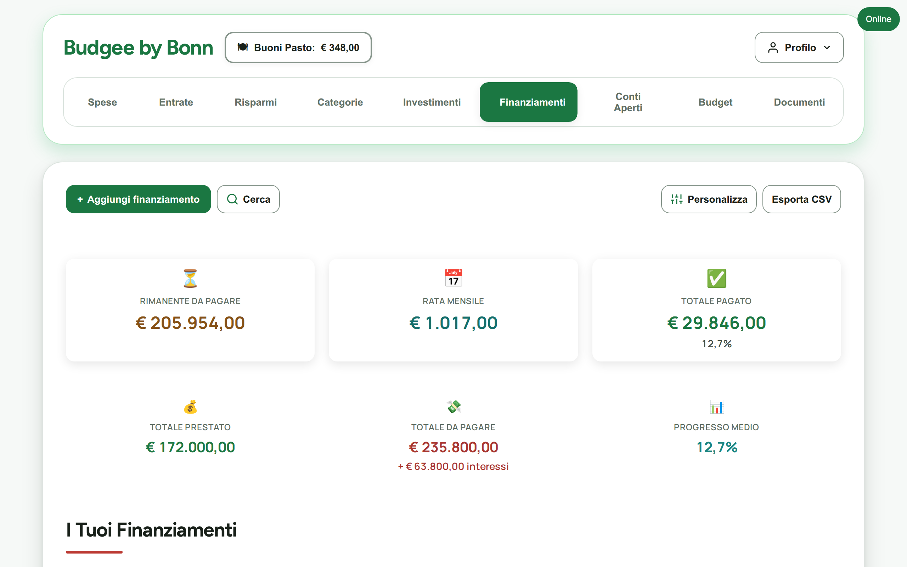

### Conti aperti

I soldi che devi e quelli che ti devono, per persona o fornitore: importi, storico dei pagamenti, conti che si chiudono da soli quando il saldo arriva a zero, totali di crediti, debiti e saldo netto, ricerca ed esportazione CSV.

### Obiettivi di risparmio

Obiettivi una tantum con scadenza o continuativi, con traguardo, importo accantonato, la cifra mensile necessaria per arrivare in tempo, avanzamento a colori, priorità e un archivio per quelli completati. La scheda della liquidità mostra quanto del saldo è accantonato per gli obiettivi.

### Transazioni ricorrenti

Affitto, stipendio, abbonamenti, bollette: giornaliere, settimanali, mensili (primo giorno, ultimo o un giorno preciso) o annuali. Ogni occorrenza chiede conferma prima di entrare nei tuoi movimenti, così nulla viene aggiunto alle tue spalle. Importo, descrizione e metodo restano modificabili, e si può eliminare una singola occorrenza o tutte quelle future.

### Analisi e confronto anno su anno

La scheda Categorie ordina le spese per macrocategoria con il dettaglio delle sottocategorie, confronta categorie di entrata e di uscita e aggiunge il riconoscimento delle abitudini con brevi suggerimenti.

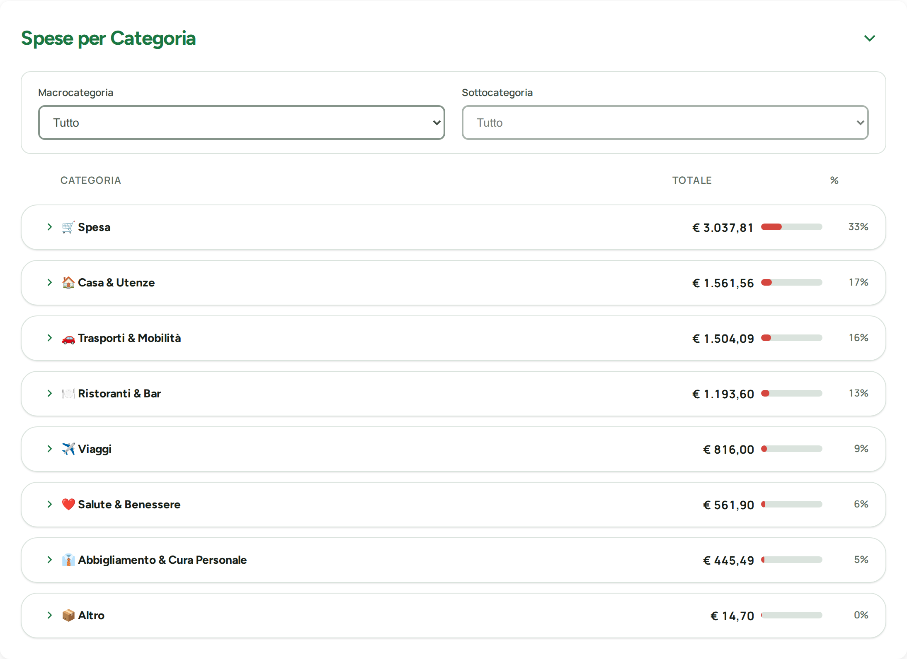

Confronta anche due anni interi, una categoria alla volta, oppure lo stesso tratto dei due anni fino alla data di oggi. Una categoria presente in un solo anno resta in tabella con l'altro anno a zero, perché una riga che sparisce è di solito quella che vale la pena guardare.

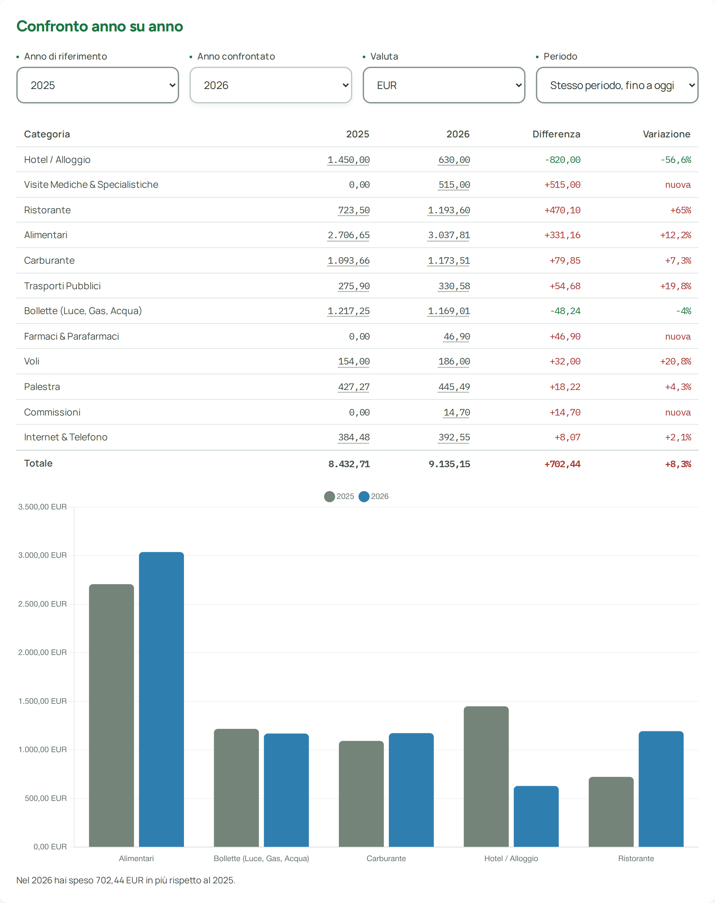

Ogni importo della tabella apre le spese che lo compongono, e ciascuna si può modificare o eliminare da lì.

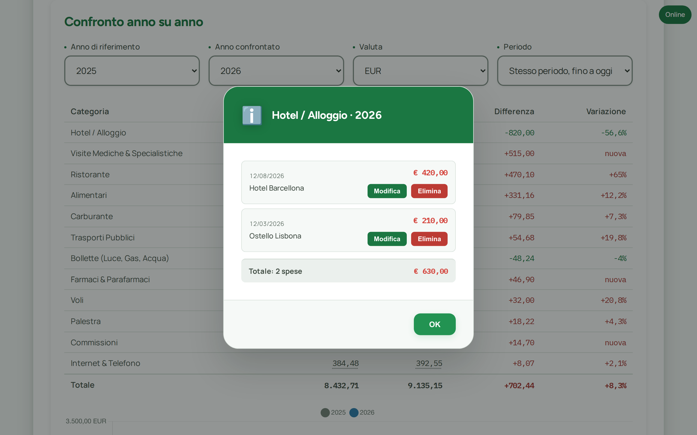

### Spese detraibili

Segna le spese come detraibili mentre le registri, vedile per anno fiscale con la ripartizione per categoria, aggiungi detraibili che non hanno una spesa corrispondente, e trova già segnate le detraibili ricorrenti.

### Documenti e backup settimanale

La scheda Documenti collega Google Drive: 32 cartelle predefinite (buste paga, fatture, referti, contratti, assicurazioni, tasse, veicoli e altro), organizzate per anno, tradotte nella tua lingua, aperte con un clic. L'accesso passa da OAuth 2.0; Budgee vede solo i file che ha creato.

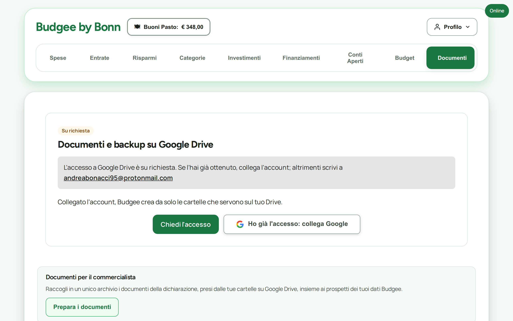

Una volta collegato Drive, Budgee scrive una copia dei tuoi dati in una cartella **Budgee Backup** ogni sette giorni e tiene le ultime otto. Non c'è un server, quindi il backup parte quando apri l'app: se non la apri per due settimane, la copia ti aspetta, e l'app ti dice quando è stata fatta davvero l'ultima.

### Documenti per il commercialista

Nel periodo delle tasse la parte difficile è ricordarsi cosa consegnare. La procedura **Documenti per il commercialista**, nella scheda Documenti, chiede quale dichiarazione presenti, per quale anno e quali situazioni ti riguardano, poi ti accompagna nelle sezioni pertinenti e indica la cartella di Drive dove di solito sta ogni documento.

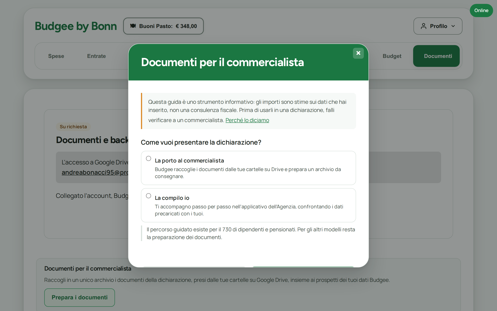

Ne esce un unico ZIP con i documenti che hai scelto, le spese detraibili dell'anno con i totali, l'elenco di ciò che manca (obbligatorio separato dal facoltativo), una nota sulle spese detraibili pagate in contanti, e l'elenco delle cose che non stanno in una cartella, come il tuo IBAN, nominate senza essere incluse. La procedura segue le regole italiane per l'anno fiscale che scegli, e un avviso in cima ricorda che gli importi sono stime che un commercialista deve verificare.

### I tuoi dati e la tua privacy

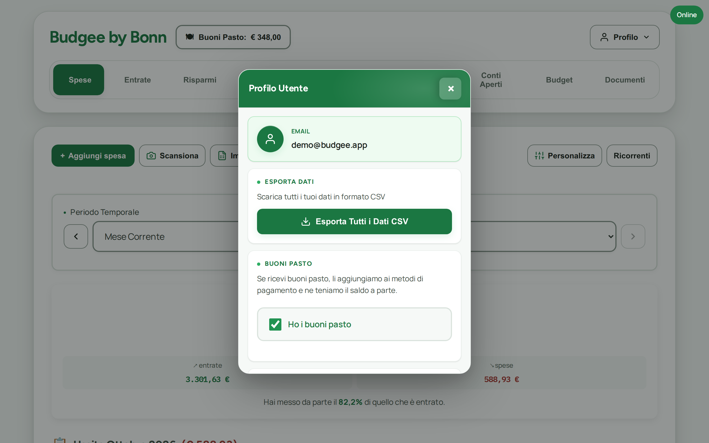

- **Porta via tutto.** Un pulsante scarica l'intero account come ZIP: un JSON completo più un CSV per sezione, letti dal database e non dalla memoria. La chiave API di Gemini resta fuori di proposito.
- **Elimina l'account del tutto.** L'eliminazione passa da ogni parte dell'account e chiede la password. Se si interrompe, l'accesso successivo la riprende dal punto in cui si era fermata.
- **Leggi cosa viene raccolto.** L'[informativa privacy](https://financial-management-by-bonn.web.app/src/pages/privacy.html), in italiano e in inglese, è raggiungibile dalla schermata di accesso, perché la raccolta comincia quando ti registri.
- **Sai a cosa acconsenti.** La registrazione chiede di accettare i [termini d'uso](https://financial-management-by-bonn.web.app/src/pages/terms.html), con la casella mai prespuntata. L'accettazione viene registrata con la versione del testo e un orario fissato dal server, e nessuno può riscriverla dopo.
- **Di' di no all'AI.** La scansione degli scontrini è spenta finché non la accendi e chiede un consenso suo.

Ogni utente può accedere solo ai propri dati, e lo impongono le regole del database; niente tracciamento, niente pubblicità.

### Lingue, tema e mobile

Italiano e inglese, scelti dal menu Profilo. Interfaccia, categorie, grafici e nomi delle cartelle seguono la lingua. L'informativa privacy e i termini compaiono solo nelle lingue in cui una persona ha letto il testo: un'interfaccia può ripiegare su un'altra lingua, un documento vincolante no.

Tema chiaro o scuro, salvato e sincronizzato:

<div align="center">
<table>
<tr>
<td></td>
<td>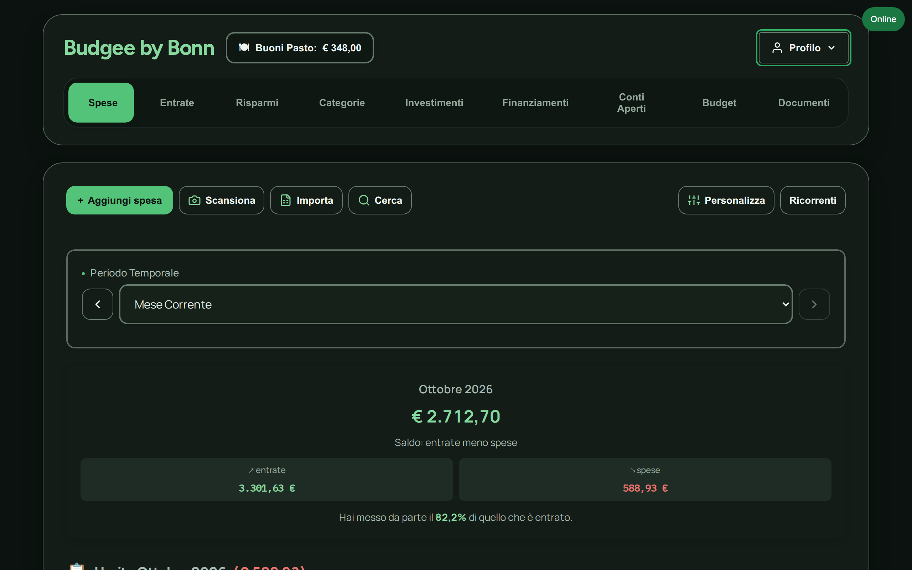</td>
</tr>
<tr>
<td align="center"><em>Tema chiaro</em></td>
<td align="center"><em>Tema scuro</em></td>
</tr>
</table>
</div>

Sul telefono le sezioni passano a una barra in basso: Spese, Entrate, Risparmi e Budget a portata di pollice, il resto sotto **Altro**. Al primo accesso un tour guidato presenta le funzioni principali.

<div align="center">
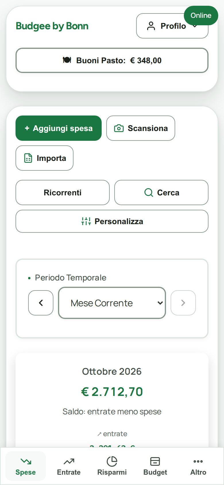
&nbsp;&nbsp;&nbsp;
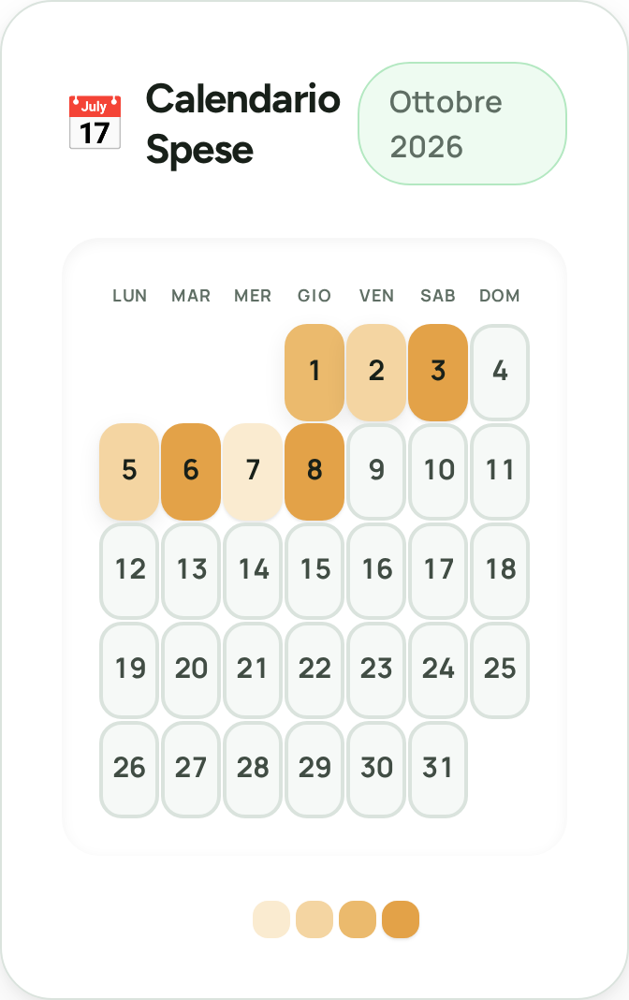
</div>

### Quando esce una nuova versione

All'apertura Budgee controlla se è stata pubblicata una versione nuova e chiede: aggiorna ora o più tardi. Finché non accetti resti sulla versione che hai aperto, così l'app non cambia sotto le tue mani mentre inserisci una spesa.

## Come contribuire

Il codice sorgente è privato, quindi i contributi arrivano come feedback. La [guida al feedback](./FEEDBACK_IT.md) spiega come segnalare un bug in modo che si possa agire, chiedere una funzione o chiedere supporto. Contatto rapido: andreabonacci95@protonmail.com

## Team e maintainer

Sviluppata e mantenuta da Andrea Bonacci - [github.com/AndreaBonn](https://github.com/AndreaBonn)

## Sicurezza

L'inventario dettagliato delle misure di sicurezza, e come segnalare una vulnerabilità, è in [SECURITY_IT.md](./SECURITY_IT.md).

## Licenza

Proprietaria. La web app è gratuita per uso personale; il codice sorgente non viene distribuito. Vedi [LICENSE](./LICENSE).

## Supporta il progetto

Se Budgee ti è stata utile, una stella su questo repository aiuta altri a trovarla.

Budgee è gratuita. Se vuoi ricambiare puoi lasciare una mancia via PayPal; l'importo lo decidi tu ed è del tutto facoltativo.

<div align="center">

[](https://paypal.me/AndreaBonacci19)

**© 2025-2026 Andrea Bonacci**

</div>
